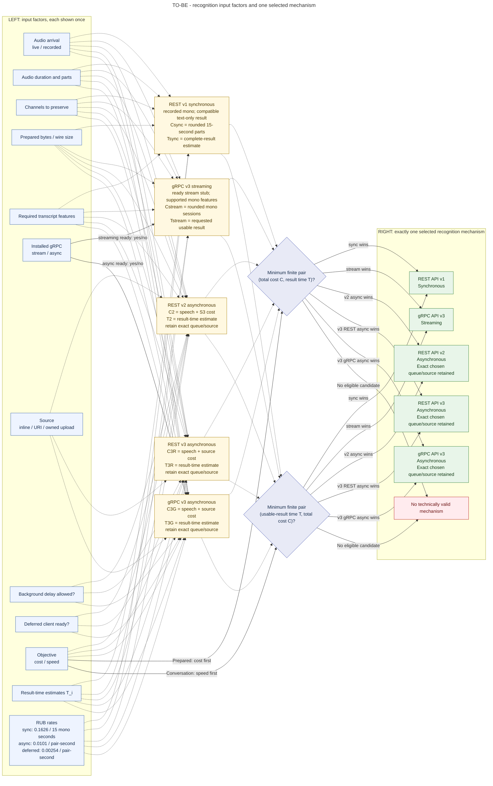

# Spec: speech-recognition selection by cost or response speed

**Status: Specify — TO-BE, companion to generation selection, 2026-11-15.**
This specifies the requested second decision tree; it does not claim all planned
modes are implemented or commissioned.

## Objective

Apply the same business rule to recognition: preserve the required transcript and
features, then minimize total charge for prepared/background work or usable-result
latency for conversation. The output is one exact recognition mechanism.

Inputs are arrival mode; audio duration and channels; actual prepared/container
bytes; language, timestamps, speaker labeling and literary requirements; explicit
API/transport controls; installed method interfaces; source access; storage and
disposal capability; delay tolerance; and price/latency estimates.

Live conversations need results while audio arrives. A later batch result cannot
satisfy that output contract. Recorded files may use synchronous, streaming or
asynchronous mechanisms only where their size/duration/format/features and ready
client interfaces permit the complete requested result.

Use (total cost C, estimated usable-result time T) for prepared transcripts and
(T,C) for conversation. Explicit budgets/deadlines remain hard constraints.
No blanket gRPC/API-version preference replaces those comparisons.

Public RUB rate snapshot including VAT, retrieved 2026-11-15:

| Recognition billing mode | Public rate |
|---|---:|
| Synchronous / streaming | RUB 0.1626 per started 15-second mono-channel unit |
| Normal asynchronous | RUB 0.0101 per second per channel pair, minimum 15 seconds |
| Deferred asynchronous | RUB 0.00254 per second per channel pair, minimum 15 seconds |

The STT billing mode, duration/channel rounding and queue determine the tariff;
API version or REST/gRPC transport alone does not determine it.

For synchronous/streaming, sum ceil(part_duration/15) × processed mono channels
over actual separately billed sessions/parts. For normal/deferred async, sum
max(15, ceil(part_duration)) × ceil(channels/2) × the applicable per-second rate.
Count overlap, per-part minimums and every separately submitted operation.

For example, a whole 60-second mono recording estimates to RUB 0.606 in normal
async, RUB 0.1524 in deferred mode when allowed, or RUB 0.6504 as one streaming
session. Splitting it into overlapping synchronous windows can increase the
charged duration. These are calculations from public rates, not invoice claims.
[Pricing and billing rules](https://aistudio.yandex.ru/ru/docs/speechkit/pricing).

Add applicable marginal storage/request/transfer charges to the speech charge.
A historical free-tier zero does not prove future operations are free.
Estimate storage from owned byte-time and the disposal plan; do not assume free
indefinite retention. Existing caller-owned input is distinct from a new temporary
upload. #98 owns automatic disposal; no broad prefix/age cleanup is introduced.

V3 local content may use inline gRPC or REST; REST does not inherently require S3.
Current client complete-wire limits are 60,000,000 protobuf bytes or 60,000,000
UTF-8 REST JSON bytes including base64/envelope. REST therefore admits less than
45,000,000 audio bytes. These are client admission guards, distinct from the
provider's published audio-file wording. Use actual prepared MP3/container bytes;
do not expand a supported compressed input to PCM just to evaluate storage need.

Storage URI or explicit partitioning becomes relevant when the selected whole-file
job does not fit inline, or the caller supplies/selects storage. API v2 requires
a source URI. Whole-file asynchronous admission is at most four hours and one GB
through storage. Over-limit recordings need explicit complete partition planning;
uploading does not remove the duration limit. Partition/overlap billing and
request-local speaker limitations remain part of eligibility.
[Source limits](https://aistudio.yandex.ru/en/docs/speechkit/concepts/limits).

Deferred mode uses the provider model tag `deferred-general`. It is a lower-priority
queue with a lower rate. Both normal and deferred asynchronous processing can take
minutes up to 24 hours, so no invented completion guarantee is made. Only enable
deferred candidates where delay tolerance, exact required model/features and
client implementation support are established. In particular, do not infer
discounted mode from an SDK function named `run_deferred`: nonblocking/FULL_DATA
operation naming is not proof of the `deferred-general` tariff.
[Async modes](https://aistudio.yandex.ru/en/docs/speechkit/stt/transcribation).

The current request builders use `general` / `general:rc` and do not expose
discounted model selection. Deferred outcomes in the proposed tree require
implementation and feature qualification before becoming eligible. The supplied
S3 export corroborated normal async and sync prices; no deferred SKU was observed
in that available export.

The provider documents at most two speakers for mono FULL_DATA labeling. The
current skill selects `general:rc` for that feature; do not presume the discounted
model supports the same requirement without verification. V1 text-only recognition cannot silently replace
required literary behavior, timing or speaker output. Literature true remains the
default; profanity masking remains disabled.
[Speaker labeling](https://aistudio.yandex.ru/en/docs/speechkit/stt/speaker-labeling).

For speed, estimate first usable transcript for live conversation and complete
deliverable transcript for a recorded request. Include conversion, transfer,
queueing, polling and formatting, with source/date/confidence. Comparable STT
timing coverage is not established by TTS timings or by a provider price table.
Use qualified estimates and normal-operation telemetry. If comparable estimates
are missing, use the same declared speed-unverified fallback as generation:
standard-priority over deferred queue for an unmeasured speed comparison, then
fewer sequential provider calls, fewer conversion/assembly passes, lower total
charge and a stable mechanism key. Include async polling/result retrieval in
that work count. Do not call this proof of a fastest route or launch paid exploration.

Each input factor appears once on the left. Each asynchronous backend evaluates
its eligible queue/source variants under the same objective and retains the exact
winning queue/source with its score. Selecting the best complete plan per backend,
then the best backend, is equivalent to minimizing over all eligible complete
plans; the final output is one resolved mechanism, not a menu of alternatives.

Every comparison below uses complete candidate plans; incompatible modes,
missing interfaces, rejected result features and unavailable source/output work
are excluded before it. The No-gRPC path masks only the affected methods.
Each deferred candidate is also masked unless its explicit admission conditions
hold. Exact ties use the other business metric, then less ancillary work.

[Open recognition tree (SVG)](speech-recognition-selection.svg) ·
[Mermaid source](speech-recognition-selection.mmd)



## Tech Stack

Existing Python >=3.11, requests, optional ready gRPC/protobuf methods, and boto3
only for helper-owned S3 operations. A readable caller source URI does not require
an upload SDK. Use stock Hermes interfaces and the configured standard runtime.
Provider-supported modes and client-implemented/commissioned modes are distinct.

## Commands

Inside the configured standard Hermes runtime:

```sh
python -m unittest tests.test_recording_storage_routes tests.test_owned_storage -v
python -m unittest discover -s tests -v
git diff --check
GITMARK_NO_GIT=1 gitmark --root . index
gitmark --root . lint
```

These are subsequent implementation checks. Research has submitted no new
recognition or synthesis requests and has not expanded live acceptance scope.

## Project Structure

```text
yandex_speech/recording_routes.py   Recording route readiness and complete operation selection
yandex_speech/grpc_stt.py          gRPC request admission and operations
yandex_speech/rest_stt.py          REST v2/v3 admission and versioned recovery
yandex_speech/recording_request.py Prepared-source and wire limits
yandex_speech/streaming.py         Arriving audio and native result contract
yandex_speech/storage.py           Owned uploads and disposal receipts
tests/                            Cost/unit/readiness and recovery regression tests
references/transcription.md        Agent-facing options and trade-offs
```

Plan defines minimal extensions for the objective/price profile and deferred mode.
Do not create a new runtime, fork Hermes or duplicate the operational billing store.

## Code Style

Use the same explicit cost/speed ranking contract as generation:

```python
score = (lambda p: (p.total_cost, p.result_latency)) if goal == "cost" else (
    lambda p: (p.result_latency, p.total_cost))
selected = min(eligible_complete_operations, key=score)
```

An accepted/uncertain operation is resumed through its receipt, not resubmitted
to pursue a later cheaper or faster estimate.

## Testing Strategy

Local tests verify 15-second minimums, one-second async rounding, channel pairs,
partition/overlap cost, inline-vs-S3 ancillary cost, lost/uncertain outcomes,
required-feature exclusions, optional-method availability and delay tolerance.
Check outputs and calculations rather than a fixed API ordering.

Reuse existing recognition evidence where applicable. New deferred mode and
performance claims require qualification before commissioning. The three live
voice-generation cases are not multiplied into recognition benchmarks; this
research does not authorize additional paid comparisons.

## Boundaries

- Always: preserve the original, required transcript/features and accepted-job
  identity; distinguish published price, actual invoice validation and estimates;
  keep private account data and source references in private project evidence.
- Ask first: extra paid tests, credential/IAM/bucket-policy changes or new runtimes.
  Explain deferred/background waiting when its business acceptance is unresolved.
- Never: choose lower cost by dropping required channels, speakers, timestamps
  or literary behavior; silently enable background/deferred delay; upload merely
  because a bucket or REST route exists; replay accepted speech; patch Hermes.

## Success Criteria

- **STT-C01:** select the lowest total-cost or usable-result-latency eligible
  mechanism according to purpose, recording the chosen objective and rationale.
- **STT-C02:** apply exact billing units, minima, channel rounding and actual
  partitions/overlap, plus applicable ancillary charges, using a dated price source.
- **STT-C03:** technical readiness, delay tolerance and output requirements exclude
  incompatible mechanisms before paid submission. Deferred requires explicit
  supported implementation/model eligibility.
- **STT-C04:** inline/S3 decisions use actual prepared content and complete-wire
  guards, preserve source/result recovery and include a disposal/cost plan.
- **STT-C05:** missing timing evidence remains identified; no unsupported speed,
  invoice, native-delivery or commissioning claim is made from mocks or merge.

## Open Questions

No numeric SLA or arbitrary cost/speed weight is invented. Deferred feature
compatibility and client exposure require qualification in Plan. The diagram is
TO-BE and does not assert that discounted modes or the new optimizer are installed.
