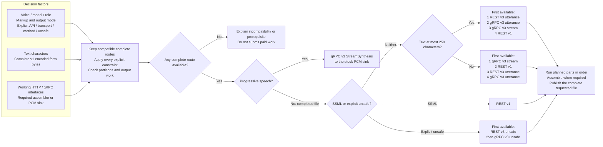

# Spec: deterministic voice-generation selection (#83)

**Status: Specify — proposed algorithm for operator review, 2026-11-15.**
This is the complete review projection of the revised #83 selection contract.
The operator retired the 65-case plan and specified three live generation tests.

## Objective

Select one executable voice-generation operation that preserves the requested
voice, model, role, pronunciation and output. Ordinary short replies use simple
REST v3 when compatible. Longer replies use v3 streaming when available, with
explicit fallbacks when optional dependencies are absent.

This revises #83's selection policy. The current code's unconditional gRPC-first
ranking is the baseline being replaced, not the proposed behavior. The policy
below is a single proposed algorithm for review; routing code is not changed by
publishing it.

| Decision factor | Effect |
|---|---|
| Selected voice/model/role and required pronunciation controls | Keep only routes that support those exact choices. Never change the voice to obtain another route. |
| Plain/native markup or XML SSML | SSML requires a compatible REST v1 route. Native stress/pronunciation marks alone do not force v1. |
| Completed file or progressive speech | Progressive speech requires a compatible gRPC v3 stream and the stock PCM sink. Completed files can use any eligible file producer. |
| Explicit API, transport, file method and unsafe mode | These constrain the candidate set. Contradictory choices produce an error. Unsafe mode is never enabled implicitly. |
| Text character count and complete v1 encoded form size | Determine request partitions. The v1 byte budget includes every form parameter. |
| Installed working HTTP/gRPC interfaces | Missing optional gRPC removes gRPC routes; no installation is performed during generation. |
| Requested format/rate and required output assembly | Exclude routes that cannot complete that output with available tools before sending paid work. |

| Possible outcome | Contract |
|---|---|
| REST v3 UtteranceSynthesis | Normal requests: at most 250 characters and the independent 24-second limit; explicit unsafe mode: up to 5,000 characters. Complete file. |
| gRPC v3 UtteranceSynthesis | Same normal/explicit-unsafe admission; used when the remaining explicit constraints/readiness select it. Complete file. |
| gRPC v3 StreamSynthesis | Progressive PCM, or complete-file collection. Up to 5,000 characters per planned provider request in this client. |
| REST v1 | Compatible voice and controls, including SSML; at most 5,000 characters and the client's 15,000-byte complete URL-encoded form budget. Complete file. |
| Actionable error | No compatible complete route, missing dependency/assembler/sink, or contradictory selections. No paid first-part experiment. |

Precedence is deterministic:

1. Apply explicit choices and voice/control/output compatibility. A priority never
   overrides these constraints.
2. Establish the complete operation for every remaining route: partitions, required
   assembly and actual interfaces. Remove operations that cannot finish.
3. For progressive speech, select the sole compatible v3 gRPC stream/sink contract.
4. For a file, take the **first remaining route** in the applicable order:

| File request | Ordered preference |
|---|---|
| Normal, at most 250 characters | **REST v3 utterance → gRPC v3 utterance → gRPC v3 stream → REST v1** |
| Normal, more than 250 characters | **gRPC v3 stream → REST v1 → REST v3 utterance → gRPC v3 utterance** |
| Explicit unsafe mode | **REST v3 unsafe utterance → gRPC v3 unsafe utterance**; other methods are excluded |
| SSML | Compatible **REST v1 only** |

Thus v1 compatibility alone never pushes a short reply onto v1. For longer plain
text, v1 is the fallback when the preferred v3 stream cannot complete the operation
and the selected voice/controls permit v1: it avoids ordinary v3's 250-character
partitioning. If v1 is also ineligible, normal v3 uses ordered 250-character parts.
An explicit API v3 choice excludes that v1 fallback.
The provider warns of possible quality degradation with unsafe mode in its
[v3 request contract](https://aistudio.yandex.ru/en/docs/speechkit/tts-v3/api-ref/Synthesizer/utteranceSynthesis),
so unsafe mode remains explicit opt-in.

Count the actual selector input after formatting. Record the whole logical reply
and any Hermes outer chunks separately; undisclosed text is not a selector input.

Text above 5,000 characters is partitioned for the selected route and assembled
into the requested complete file. V1 may require partitioning earlier because of
its encoded-byte budget. Independent MP3/Ogg outputs require an available encoded
joiner; WAV/LPCM assembly uses the existing standard-library path. One complete
provider container requires no joiner just to save it. Selection checks these
requirements before the first paid request.



Every 'available' route in the chart already passed the exact voice, explicit-choice,
dependency and complete-output checks. Consequently, unsupported SSML/progressive
or voice/API combinations reach the error before the chart's output branches.

A definite connection failure before the first synthesis RPC may remove that
transport and repeat this selection with unchanged user choices. Accepted or
uncertain work is not automatically replayed on another route. A definite normal
v3 duration rejection permits bounded splitting on that same method; the duration
limit cannot be inferred from character count alone.

## Tech Stack

Existing Python >=3.11 skill, requests HTTP runtime and optional installed
Yandex gRPC/protobuf interfaces. Already usable generated stubs do not require
installing the proto compiler. Use existing audio collection/assembly and stock
Hermes file/PCM interfaces; introduce no provider, runtime or host source patch.

Provider admission references: [limits](https://aistudio.yandex.ru/en/docs/speechkit/concepts/limits),
[v1 form](https://aistudio.yandex.ru/en/docs/speechkit/tts/request),
[v3 REST utterance](https://aistudio.yandex.ru/en/docs/speechkit/tts-v3/api-ref/Synthesizer/utteranceSynthesis),
and [v3 stream](https://aistudio.yandex.ru/en/docs/speechkit/tts-v3/api-ref/grpc/Synthesizer/streamSynthesis).
The v1 client enforces a 15,000-byte form budget; the vendor describes 15 KB.
Do not promote the client's per-RPC streaming policy into a different service-session limit.

## Commands

Inside the configured standard Hermes runtime:

```sh
python -m unittest tests.test_tts_selection tests.test_tts_dispatch -v
python -m unittest discover -s tests -v
git diff --check
GITMARK_NO_GIT=1 gitmark --root . index
gitmark --root . lint
```

These commands describe verification after the revised algorithm is implemented.
No project/private venv, hardcoded interpreter or dependency installation.

## Project Structure

```text
yandex_speech/tts_selection.py       Complete-route filtering and ordered selection
yandex_speech/tts_capabilities.py    Actual dependency and output-tool readiness
yandex_speech/tts_text.py            Character/encoded-form admission and partitioning
scripts/tts.py                     Selected operation execution and complete publication
integrations/hermes/tts_provider.py Stock file/PCM provider boundary
tests/test_tts_selection.py         Deterministic decision and unavailable-route checks
tests/test_tts_dispatch.py          End-to-end local dispatch/partition outcomes
references/synthesis-provider-testing.md Maintained agent guide after approval
```

Existing #83 requirements remain in its owning task area and GitHub tracker. #98
cleanup work remains independently authorized; it does not decide the TTS route.

## Code Style

Keep explicit immutable request values and ordered complete-route candidates.
Illustrative policy, not a claim of implementation:

```python
for candidate in ordered_routes(request):
    if candidate.supports(request) and candidate.can_complete(request, runtime):
        return candidate
raise SpeechError("PREREQUISITE", "no complete compatible route is ready")
```

Never mutate the selected voice or silently enable unsafe mode during fallback.

## Testing Strategy

Use local deterministic tests for explicit choices, voice/method compatibility,
missing/broken dependencies, SSML, unsafe mode, output formats, encoded v1 bytes,
250/5,000 boundaries and failure disposition. These do not create extra paid cases.

**Exactly three live voice-generation tests on One-ring:**

| Complete reply length | Question and expected default result |
|---|---|
| 200 characters: below 250 | Does the ordinary short reply use REST v3 and deliver the complete selected voice? |
| 1,000 characters: middle band below 5,000 | Does available compatible v3 gRPC streaming avoid ordinary 250-character splitting and deliver the complete reply? |
| 5,500 characters: above 5,000 | Does the selected route partition/assemble the whole reply, with its final tail delivered in the same voice? |

The long case must actually exercise a greater-than-5,000-character selector
input; upstream host chunking into smaller callbacks alone does not prove that
branch. Use the existing isolated One-ring test scope, preserving permanent
production configuration, and record the real call boundary.

Use the same selected voice/model/role and automatic API/transport/method settings
for these three. Record the actual route, whole-input length, completed output and
addressed delivery. Expected gRPC outcomes require the tested runtime's compatible
stream interface; unavailable dependencies are proved locally, not by multiplying
live runs. Staging cleanup can be checked within these same three TTS operations.
There is no live voice/API cross-product or extra 250/5,000 boundary run. The old
65-case matrix is retired, not paused or waiting to resume.

## Boundaries

- Always: preserve selected identity, controls and output; honor explicit constraints;
  preflight the complete operation; report selected route and exclusion reasons.
- Ask first: activation of a revised production policy, new dependencies or host
  changes, additional paid test cases or different user voice/quality choices.
- Never: change voices, enable unsafe implicitly, install a missing runtime during
  generation, return a prefix as complete, replay accepted/uncertain paid work,
  use S3 as a TTS routing requirement or resurrect the retired 65-case matrix.

## Success Criteria

- **AC83-03 revised:** apply the factors, outcomes and exact preference orders above;
  at most 250 characters uses REST v3 by default when it supports the request and
  is ready. Both-version voice support does not select v1 automatically. Explicit
  choices and exact method compatibility remain constraints.
- **AC83-04 retained:** calculate complete request partitions from the selected
  method's character, encoded-body and duration limits; retain order, final tail
  and requested output without unnecessary conversion or incomplete publication.
- **AC83-09/10 retained:** unavailable dependencies or output assembly exclude only
  affected complete routes; choose the first remaining route or diagnose the exact
  prerequisite before paid work. Never claim readiness from package metadata alone.
- **AC83-11 replaced:** exactly the three One-ring cases above prove short, middle
  and long complete replies. Local tests cover decision combinations and exact
  boundaries. Prior acceptance evidence remains historical; it does not validate
  a revised selector. Commissioning and merge require the applicable final evidence.

## Open Questions

The decision for review is the proposed automatic preference order, especially
REST v3 for short replies and compatible REST v1 as the long-file fallback when
usable v3 streaming is absent. Approval advances this revision to implementation
planning; no routing activation or additional live tests are inferred.
