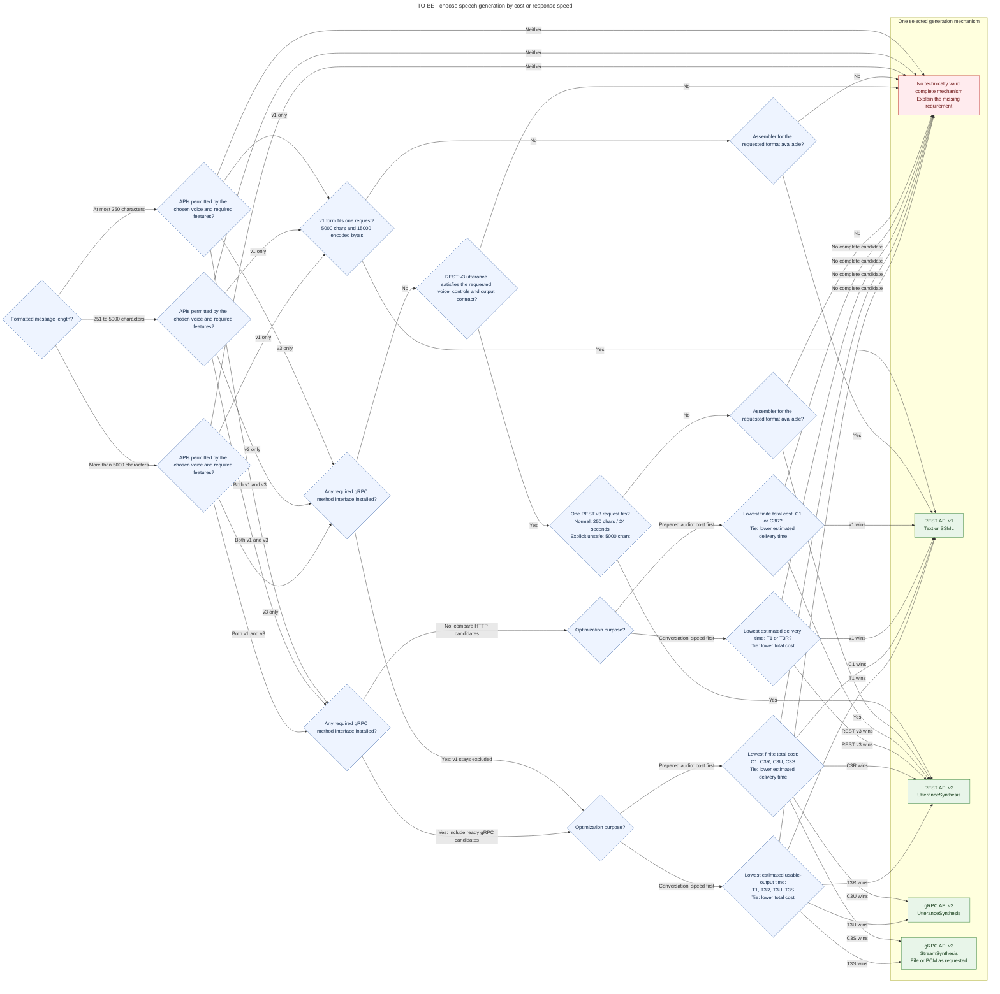

# Spec: speech-generation selection by cost or response speed (#83)

**Status: Specify — TO-BE, business requirements and evidence model, 2026-11-15.**
This replaces the earlier fixed protocol preference. It does not describe deployed
selection behavior or approve routing activation.

## Objective

Choose the technically valid complete generation operation that best serves the
request's business purpose. **Cost and speed are optimization objectives.**
The selected voice, model, role, pronunciation, quality and output are constraints.

The operator's instructions, translated into English and incorporated here, are:

- Produce two simple trees: generation first, recognition second. Separate input
  factors branch on the left; one selected mechanism is the output on the right.
  Think of input pins on a circuit selecting one output, rather than a box listing
  every possible mechanism.
- For conversation, prioritize response speed and convenience. Discord speech
  and conversational Telegram voice messages are examples.
- For voicing an already written message or preparing audio outside an immediate
  conversation, prioritize cost. The platform name alone does not decide the goal.
- Choose the cheapest eligible complete operation for the cost goal. For speed,
  choose the best estimated usable-output time within the request's constraints.
  Research actual charging rules and billing evidence rather than imposing an API
  version preference or using RPC count as a price.
- Translate subsequent clarifications into project documents. Preserve the
  selected voice/result and technical constraints. Exactly three live generation
  cases remain; the retired 65-case expansion must not resume.

Use these two ordered scores; no arbitrary weighting constants are introduced:

| Purpose | Primary objective | Secondary objective |
|---|---|---|
| Prepared / non-interactive audio | Lowest expected total charge C | Lower estimated usable-output time T |
| Conversation | Lowest estimated usable-output time T | Lower expected total charge C |

Prepared output is a complete audio file. Its internal producer may use a
streaming RPC without turning the task into progressive conversation. Explicit
method restrictions still remain binding.

Any explicit budget, deadline or mechanism selection is a hard constraint.
An ineligible producer has no finite score and cannot win. Exact ties prefer less
conversion/assembly/startup work, then a stable identifier for determinism.

For each complete eligible operation, calculate its actual planned parts, C and T.
Choose the minimum (C, T) for prepared audio, or (T, C) for conversation. There is
no universal v1-first, v3-first, REST-first or gRPC-first policy.

Inputs include the actual formatted text and native outer chunks; fixed selected
voice/model/role; SSML/native markup; file or progressive PCM contract; installed
method interfaces; required assembly/conversion; explicit unsafe permission;
applicable price book; and comparable latency evidence.

Public RUB price snapshot, including VAT, retrieved 2026-11-15:

| Model / API | Price input |
|---|---:|
| API v1 | RUB 1,342 per million submitted characters |
| API v3 general | RUB 0.1626 per billable text block |
| API v3 livetts | RUB 0.25 per billable text block |

The [provider pricing rules](https://aistudio.yandex.ru/ru/docs/speechkit/pricing)
define v3's 250-character accounting. Compute units for each submitted part;
normal utterance requests each consume a unit, while long/streamed work is
estimated from rounded 250-character blocks. Do not equate one long RPC with
one charged unit. Keep exact-boundary/flush-granularity uncertainty visible until
reconciled against metering; it is not permission for extra paid experiments.

For v1, estimate C1 = 1342 × sum(actual submitted characters) / 1,000,000.
For v3, estimate C3 = selected model rate × sum(billable blocks of actual parts).
URL-encoded bytes constrain v1 admission; they are not the character-price unit.
Outer chunking, markup wrappers, overlaps/retries and forced flush boundaries
must not disappear from the estimate.

For the same general voice eligible for both APIs, a 100-character prepared
request costs an estimated RUB 0.1342 through v1 versus RUB 0.1626 through normal
v3. At 200 characters the figures are RUB 0.2684 and RUB 0.1626. Thus the
cheapest API can change within the short band; the normal single-unit crossover
is between 121 and 122 characters at these rates. This is a calculated example
using public tariffs, not a per-request invoice measurement.

At 1,000 characters, one v3 operation with four billing blocks estimates to RUB
0.6504, while five separately billed normal parts cost RUB 0.813. Actual planned
part lengths determine the answer. API v1 at 1,000 submitted characters estimates
to RUB 1.342. No voice/model change is allowed to obtain those comparisons.

T is specific to delivery: complete deliverable-file time for Telegram/file
messages; first usable PCM at the host sink for speaking. Include startup,
required conversion, assembly and delivery work. A provider fragment timestamp
is not a listener/playback timestamp, and LLM/admission delay is not a synthesis
mechanism measurement.

Existing matched One-ring tool receipts for a synthetic 1,000-character
Ermil/general/good Ogg reply recorded file-ready times of about 8.42 s for v1,
3.02 s for normal REST v3 and 1.40 s for gRPC v3 streamed-file output.
These are historical individual observations, not universal guarantees or
commissioning of the revised selector. Their detailed source references remain
private. Use producer, normal/unsafe mode, voice/model/role, requested controls, format,
size, outer-chunk policy and startup-matched profiles; identify
inferred or missing estimates. Unknown latency is never represented as zero.
Use the latency comparison when comparable estimates exist for every candidate
being compared. Otherwise use a declared structural fallback for that comparison:
fewer sequential provider RPCs, then fewer conversion passes, fewer assembly
passes, lower expected charge and a stable mechanism identifier. Mark the result
speed-unverified; RPC count is only this fallback latency proxy, never a tariff.
For cost ties use comparable latency, or the same declared fallback when missing.
Collect telemetry from ordinary work; launch no paid exploration and advertise
no proven fastest route from the fallback.

Normal v3 utterance is limited to 250 characters and 24 seconds; unsafe and
streamed-file requests admit up to 5,000 in the current client. V1 enforces
5,000 characters and a 15,000-byte complete encoded-form budget. Longer input
requires complete assembly. Actual per-method controls and framing are checked
before paid work; installed gRPC packages alone do not prove a ready collector.
Unsafe remains explicit because its quality trade-off must not be introduced
by the cost optimizer. [Limits](https://aistudio.yandex.ru/en/docs/speechkit/concepts/limits).

In the diagram, C1/T1 describe REST v1, C3R/T3R REST v3 utterance,
C3U/T3U gRPC v3 utterance, and C3S/T3S gRPC v3 streaming.
Each pair is a complete-operation estimate after hard eligibility checks.
An unsupported interface, voice, control, output or missing assembler removes
that candidate; a speed estimate also carries its evidence/confidence.
The gRPC question enables only individually verified method interfaces.

[Open generation tree (SVG)](voice-generation-selection.svg) ·
[Mermaid source](voice-generation-selection.mmd)



## Tech Stack

Existing Python >=3.11 skill, requests HTTP runtime and optional installed
Yandex gRPC/protobuf interfaces. A working packaged stub does not require
the proto compiler. Reuse current file/PCM collectors and stock Hermes APIs.
No ordinary generation request needs Billing API privileges: use an applicable
dated price book; optional private billing reconciliation is separate.

The supplied One-ring pricing-comparison session was read as the method precedent.
Five distinct speech SKUs in its existing November S3 export corroborated the
published RUB synthesis, synchronous and normal-asynchronous rates. The source
is an existing export, not a claimed fresh Usage API call. It does not separate
REST/gRPC tariffs. Actual usage quantities, account identifiers and source
session/message references remain private.

## Commands

Inside the configured standard Hermes runtime:

```sh
python -m unittest tests.test_tts_selection tests.test_tts_dispatch -v
python -m unittest discover -s tests -v
git diff --check
GITMARK_NO_GIT=1 gitmark --root . index
gitmark --root . lint
```

Commands apply to subsequent implementation. Research so far reuses existing
billing and timing records and has made zero new speech-generation calls.

## Project Structure

```text
yandex_speech/tts_selection.py        Complete-operation eligibility and objective ranking
yandex_speech/tts_capabilities.py     Actual optional method/assembler readiness
yandex_speech/tts_text.py             Actual text parts and encoded-form admission
scripts/tts.py                      Execution and complete publication
integrations/hermes/tts_provider.py  Stock file/PCM boundary and per-call context
tests/                              Deterministic score/eligibility regression tests
references/                         Portable agent instructions after approval
```

Plan will define the smallest price/profile interface within existing scope.
Prepared whole-file and native outer-chunk boundaries must be explicit: an SDK
callback cannot claim knowledge of undisclosed whole-message text. Aggregate
whole-message charges from the actual formatter/chunk/part boundaries.
#98 artifact cleanup remains independently authorized and unfinished.

## Code Style

Use explicit goal, immutable request identity and complete-operation estimates:

```python
key = (lambda p: (p.cost, p.usable_latency)) if goal == "cost" else (
    lambda p: (p.usable_latency, p.cost))
selected = min(eligible_complete_operations, key=key)
```

This is specification pseudocode, not an implemented API. Resolve estimates
and hard eligibility before comparison; do not silently substitute a voice.

## Testing Strategy

Use deterministic local tests for price-book units, rounding/partitions,
the 121/122 example, voice/feature exclusions, missing method interfaces,
missing assembly, cost/speed trade-offs, unknown latency and explicit controls.
Verify these outcomes rather than mirroring a priority list.

Exactly three One-ring generation cases remain: 200 / 1,000 / 5,500 characters,
one per length band, with the same selected voice/model/role. Record purpose,
selected mechanism, planned/actual units, expected cost, relevant latency, complete
tail and addressed delivery. Include a conversation and prepared-audio purpose
across those cases; local tests cover both goals at every boundary.
The long case must actually exercise a greater-than-5,000-character selector
input in the existing isolated scope; record host outer chunks separately.
Do not expand them into a live voice/API matrix.

## Boundaries

- Always: preserve the required result/quality; optimize only eligible complete
  operations; expose goal, cost/time estimates, source/date/confidence and exclusions.
- Ask first: extra paid comparisons, new dependencies, IAM/credential/bucket-policy
  changes or live routing activation beyond approved scope.
- Never: use API recency/RPC count as a price; treat missing timing as zero;
  change voices, enable unsafe implicitly, replay accepted/uncertain work,
  patch Hermes or revive the retired test expansion.

## Success Criteria

- **AC83-03 revised:** selection minimizes (C,T) or (T,C) according to purpose,
  with hard requirements preserved and the winning objective/exclusions recorded.
- **AC83-04 retained:** cost uses actual formatted/partitioned submissions and
  complete output work; the whole reply and final tail are preserved.
- **AC83-06/07 revised:** public tariff, private invoice validation, local plan
  and measured latency remain distinguished; first fragment is not playback.
- **AC83-09/10 retained:** dependencies, exact voice/method/control support and
  assembly constrain eligibility rather than silently changing the output.
- **AC83-11 replaced:** exactly three live voice cases; local combinations and
  old records do not commission a revised selector by themselves.

## Open Questions

The operator has supplied the objective distinction; no invented numeric weights
or latency SLA are proposed. Profiles with inadequate timing evidence remain
qualified estimates. Review concerns this business policy and eligibility/cost
contracts; current runtime routing has not been changed to implement them.
